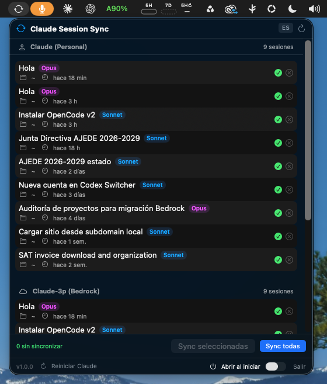

# Claude Session Sync

<p align="center">
  
</p>

<p align="center">
  <strong>Sync your Claude Code sessions across accounts.</strong><br>
  <em>Never lose your session history when switching between Personal and Bedrock accounts.</em>
</p>

<p align="center">
  <a href="#the-problem--el-problema">Problem</a> •
  <a href="#the-solution--la-solución">Solution</a> •
  <a href="#macos">macOS</a> •
  <a href="#windows">Windows</a> •
  <a href="#how-it-works--cómo-funciona">How it works</a>
</p>

---

## The Problem / El Problema

**EN:** Claude Desktop stores Code session indexes in separate directories per account. When you switch between Personal and Bedrock (or between multiple personal accounts), your sessions disappear from the sidebar. The actual conversation transcripts are shared on disk -- but the index files are siloed per account.

**ES:** Claude Desktop guarda los indices de sesiones de Code en directorios separados por cuenta. Al cambiar entre Personal y Bedrock (o entre varias cuentas personales), las sesiones desaparecen del sidebar. Las transcripciones reales se comparten en disco, pero los archivos de indice estan aislados por cuenta.

**Related issues / Issues relacionados:**
- [#92825](https://github.com/anthropics/claude-code/issues/92825) -- Sessions lost after account switch
- [#92813](https://github.com/anthropics/claude-code/issues/92813) -- Account switch pauses running tasks
- [#90647](https://github.com/anthropics/claude-code/issues/90647) -- Account switch discards MCP OAuth grants
- [#92517](https://github.com/anthropics/claude-code/issues/92517) -- Feature request: cross-account session sharing

## The Solution / La Solución

**EN:** This tool copies the lightweight session index JSON files (~1-5KB each) between account directories, making all your sessions visible regardless of which account is active. It does NOT copy conversations or credentials -- just the metadata that tells the sidebar "this session exists."

**ES:** Esta herramienta copia los archivos JSON de indice de sesion (~1-5KB cada uno) entre los directorios de cuentas, haciendo que todas tus sesiones sean visibles sin importar que cuenta este activa. NO copia conversaciones ni credenciales, solo los metadatos que le dicen al sidebar "esta sesion existe."

<p align="center">
  
</p>

## macOS

Native SwiftUI menubar app. No background processes, no Electron, just a lightweight binary.

App nativa de SwiftUI en la barra de menu. Sin procesos en segundo plano, sin Electron, solo un binario ligero.

### Features / Funcionalidades

| Feature | Description |
|---------|-------------|
| Session list | View all sessions from all accounts grouped by source |
| Selective sync | Choose which sessions to sync with checkboxes |
| Sync all | One-click bidirectional sync |
| Unsync | Remove a synced session from the other account |
| Restart Claude | Restart Claude Desktop so synced sessions appear immediately |
| Launch at login | Toggle to start automatically when you log in |
| EN/ES toggle | Switch between English and Spanish in-app |
| Multi-account | Syncs between Claude (Personal), Claude-3p (Bedrock), and multiple accounts within the same app |
| **Vault** | Daily backup of index files **and** transcripts to a location Claude never prunes |
| **Restore** | Put back sessions Claude has deleted, byte for byte |
| **Auto-restore** | Every backup pass returns anything that disappeared since the last run |

### Install / Instalar

**Requirements:** macOS 14+ and Swift 6.0+ (comes with Xcode Command Line Tools).

```bash
git clone https://github.com/ANGELBERRIOS23/claude-session-sync.git
cd claude-session-sync
./install.sh
```

This builds the binary and creates `Claude Session Sync.app` in `/Applications/`. Find it in Launchpad or Spotlight.

### Build manually / Compilar manualmente

```bash
swift build -c release
.build/release/ClaudeSessionSync
```

## Windows

PowerShell script with an interactive menu. No installation required.

Script de PowerShell con menu interactivo. No requiere instalacion.

### Run / Ejecutar

```powershell
powershell -ExecutionPolicy Bypass -File windows\claude-session-sync.ps1
```

### Flags

```powershell
.\claude-session-sync.ps1 -List             # List all sessions / Listar sesiones
.\claude-session-sync.ps1 -SyncAll          # Sync everything / Sincronizar todo
.\claude-session-sync.ps1 -Backup           # Back up to the vault / Respaldar
.\claude-session-sync.ps1 -RestoreMissing   # Put back what Claude deleted / Restaurar
.\claude-session-sync.ps1 -InstallDaily     # Schedule a daily backup / Respaldo diario
.\claude-session-sync.ps1 -VaultPath D:\backups -Backup   # Vault on another drive
.\claude-session-sync.ps1 -Help             # Show help / Mostrar ayuda
```

### Interactive menu / Menu interactivo

```
--- Claude Session Sync ---
1. List sessions
2. Sync all sessions
3. Back up now (vault)
4. Restore what Claude deleted
5. Vault status
6. Enable daily backup
7. Disable daily backup
8. Restart Claude (Personal)
9. Restart Claude-3p (Bedrock)
0. Quit
```

> **Note:** the macOS app is tested (see below). The Windows script mirrors its logic but
> has not been run on a Windows host yet — reports welcome.

## How it works / Cómo funciona

### Session storage / Almacenamiento de sesiones

| Platform | App | Path |
|----------|-----|------|
| macOS | Claude (Personal) | `~/Library/Application Support/Claude/claude-code-sessions/{accountUUID}/{orgUUID}/` |
| macOS | Claude-3p (Bedrock) | `~/Library/Application Support/Claude-3p/claude-code-sessions/{accountUUID}/{orgUUID}/` |
| Windows | Claude (Personal) | `%APPDATA%\Claude\claude-code-sessions\{accountUUID}\{orgUUID}\` |
| Windows | Claude-3p (Bedrock) | `%APPDATA%\Claude-3p\claude-code-sessions\{accountUUID}\{orgUUID}\` |

### What gets copied / Qué se copia

**Sync** copies only `local_*.json` index files. These are small (~1-5KB) and contain session metadata: title, model used, working directory, and timestamps. No conversation content. No credentials. No API keys.

**Sync** copia solo los archivos de indice `local_*.json`. Son pequenos (~1-5KB) y contienen metadatos de sesion: titulo, modelo usado, directorio de trabajo, y timestamps. Sin contenido de conversaciones. Sin credenciales. Sin API keys.

**Vault** additionally copies the transcripts themselves, from `~/.claude/projects/`, because they do not survive on their own (see below). Credentials are never read by either feature.

**Vault** ademas copia las transcripciones, desde `~/.claude/projects/`, porque no sobreviven por si solas (ver abajo). Ninguna de las dos funciones lee credenciales.

## The vault / El respaldo

**EN:** Sessions have two halves that Claude stores separately and prunes on different clocks: the index row the sidebar lists, and the transcript that holds the actual conversation. Either can disappear while the other survives, so the vault captures both independently and can restore either on its own.

**ES:** Las sesiones tienen dos mitades que Claude guarda por separado y borra en tiempos distintos: la fila de indice que lista el sidebar, y la transcripcion con la conversacion real. Cualquiera puede desaparecer mientras la otra sobrevive, asi que el respaldo captura ambas por separado y puede restaurar cualquiera de las dos.

Measured on one macOS install (2026-09-09): 92 transcripts on disk, only 10 of them referenced by an index row. **82 transcripts had no sidebar entry pointing at them.** 53 of the 92 were subagent transcripts, which sit a level deeper than the obvious path and are missed entirely by a flat scan.

| Property | Behaviour |
|---|---|
| Location | `~/Library/Application Support/ClaudeSessionSync/Vault` by default, or any folder you pick — external drive, iCloud, Dropbox |
| Storage | Content-addressed by SHA-256, so a daily run over unchanged transcripts writes nothing |
| Compression | Blobs are deflated. 645 MB of transcripts occupy 344 MB. Sessions holding base64 attachments are stored raw, since they do not deflate and would cost CPU on every read for nothing |
| Compaction | Blobs no entry references any more are deleted on every backup, so trimmed version history does not accumulate |
| Versions | Every revision is kept, and the **largest** is pinned — a transcript Claude truncates cannot overwrite the full copy |
| Restore | Always recovers the fullest version ever captured, not the newest |
| Live files | Never overwritten. Claude Code appends to an open handle, so replacing the file would strand everything written afterwards; the fuller copy goes into `Vault/recovered/` instead |
| Schedule | `launchd` on macOS, Task Scheduler on Windows — both configured to catch up after the machine was asleep |
| Subagents | Captured, including `<slug>/<sessionId>/subagents/agent-*.jsonl` |

### What it does not do / Lo que no hace

This is a client-side backup. It cannot recover a session that was already gone before the first backup ran, and it does not stop Claude from pruning — it puts things back afterwards. The upstream retention behaviour is tracked in [anthropics/claude-code#92825](https://github.com/anthropics/claude-code/issues/92825).

Es un respaldo del lado del cliente. No puede recuperar una sesion que ya se habia perdido antes del primer respaldo, y no impide que Claude borre — las devuelve despues.

### Important note / Nota importante

Synced sessions are **read-only** in terms of continuing the conversation -- you can see and read them, but generating new responses requires the original account's API credentials. The session appears in the sidebar and you can review the full transcript.

Las sesiones sincronizadas son de **solo lectura** en terminos de continuar la conversacion -- puedes verlas y leerlas, pero generar nuevas respuestas requiere las credenciales API de la cuenta original. La sesion aparece en el sidebar y puedes revisar la transcripcion completa.

## Verification / Verificacion

Recovery was tested against real deleted sessions on macOS 26.6, not just against index
visibility. Each case deletes or truncates an actual transcript and checks the SHA-256 of
what comes back.

| Case | Result |
|---|---|
| Transcript deleted from disk | Restored to its exact path, **byte-identical** (56,850 bytes, SHA-256 match) |
| Transcript truncated to a 36-byte stub | Live file left untouched; full 67,241-byte copy recovered into `Vault/recovered/`, **byte-identical** |
| Subagent transcript deleted | Restored, byte-identical |
| Backup coverage | 92 of 92 transcripts captured, including all 53 subagent transcripts |
| Repeat backup | 21 MB written on the second run over 645 MB of transcripts (content-addressed dedupe) |

Two bugs were found by these tests and fixed before release: a flat directory scan that
missed all 53 subagent transcripts, and a single-blob-per-entry model in which a truncated
capture overwrote the pointer to the full copy. Version history now pins the largest
revision.

## FAQ

**Q: Is this safe? / Es seguro?**
A: Yes. Sync copies tiny JSON metadata files. The vault additionally copies transcripts, which are your own conversation files. No passwords, tokens, or credentials are read.

**Q: How big does the vault get? / Cuanto ocupa el respaldo?**
A: About half the size of `~/.claude/projects`, then only what changed. On the test install, 645 MB of transcripts became a 344 MB vault. Blobs are deduplicated by content hash and deflated. Use `--compact` (or the **Reclaim space** button) to sweep unreferenced blobs and compress anything left over from an older version.

**Q: My disk is nearly full. / Casi no tengo espacio.**
A: Point the vault at another drive with **Change location** in the app, or `-VaultPath D:\backups` on Windows. The vault is a plain directory and can live on an external or synced volume.

**Q: Can it recover a session that disappeared before I installed it?**
A: No. It can only restore what it captured. Install it before you need it.

**Q: Do I need to restart Claude after syncing?**
A: Usually yes. Use the "Restart Claude" button in the app, or press Cmd+Q and reopen.

**Q: Will this break anything? / Puede romper algo?**
A: No. The worst case is a session appearing that you can't continue (because it belongs to another account). You can always unsync it.

**Q: Does it work with multiple personal accounts?**
A: Yes. It scans all account UUID directories and syncs between all of them.

## License

MIT

## Contributing

PRs welcome. If you find a bug or want a feature, open an issue.
